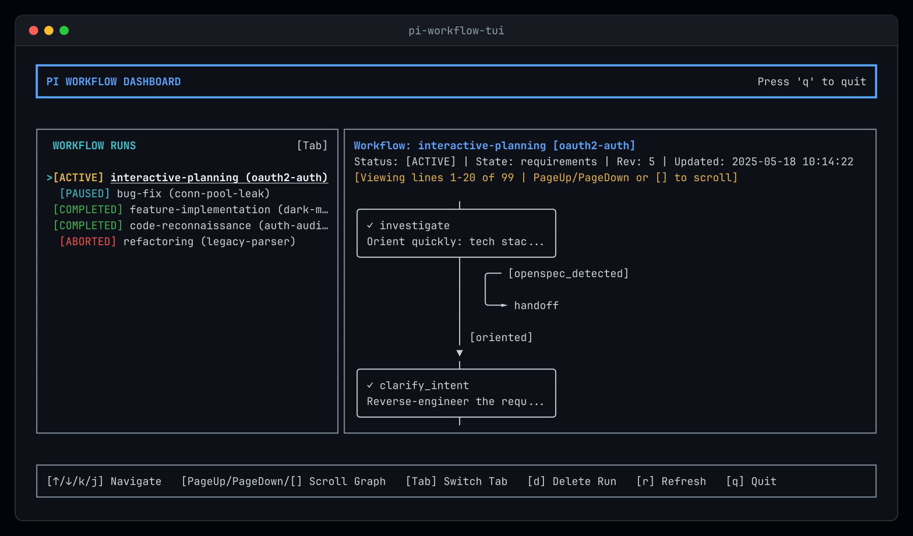
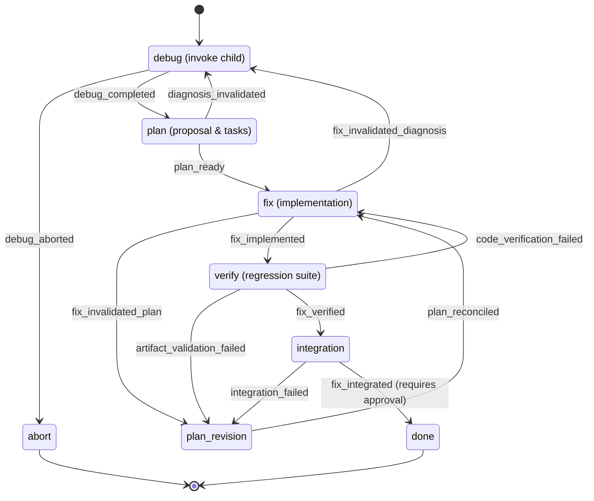

In my previous posts on [orchestrating agents with herdr, chezmoi, and nvim]() and [Pi - The
extensible agent harness](), I focused on the execution and tooling environment: decoupling long-running
tasks into persistent terminal panes, driving Neovim over RPC, and building on a
lean agent harness with an in-process TypeScript extension engine.

However, having visibility and sharp tools only solves half the problem. When
you set an AI agent to work on non-trivial engineering tasks - such as
rearchitecting an authentication layer, tracking down a subtle concurrency bug,
or implementing a feature from scratch with tests - a deeper question arises:
**how do we ensure consistent process, repeatable quality, and potentially
smooth team collaboration?**

Without an explicit process model, autonomous agents can run into several
failure modes: drifting off-topic, skipping verification gates, thrashing in
unproductive editing loops, or losing track of earlier decisions when long
sessions get compacted.

More importantly, it is not just about governing the agent; it is about
establishing **repeatable workflows** that deliver **consistently high quality**.
When engineering standards - such as requiring root-cause reproduction before
patching, establishing clear acceptance criteria, and validating design
decisions with human sign-offs - are codified into an executable engine, the
entire team could benefit from a shared, dependable process.

Here is why I moved away from harness-neutral, prompt-based workflow skills, how
I designed [`pi-workflow-executor`](https://github.com/gierdo/pi-workflow-executor)
as an authoritative, state-machine engine for Pi, and how deterministic
orchestration changes daily work.

## The Limits of Prompt-Driven Workflows

My first attempt at structuring complex agent tasks was intentionally
harness-independent. In my dotfiles, I maintained a [generic workflow-executor
skill](https://github.com/gierdo/dotfiles/blob/03b4ca1d7bf1afc20fde63b61886f26eb8773c96/skills/workflow-executor/SKILL.md)
alongside declarative YAML workflows (`feature-implementation`, `bug-fix`,
`interactive-planning`).

The workflow definition declared states, artifact requirements, exit gates, and
transitions:

```yaml
initial: intake

states:
  intake:
    goal: Clarify scope and read existing codebase patterns.
    exit_gate: Scope agreed and requirements documented.
    transitions:
      - when: Scope clarified
        to: plan
  plan:
    goal: Create detailed implementation plan.
    exit_gate: Plan written and verified.
    transitions:
      - when: Plan complete
        to: implement
```

The theory was appealing: by presenting this YAML to the LLM inside a system
prompt or skill, the model acts as the orchestrator. It evaluates natural-language
predicates (`when`, `exit_gate`), records each step in an append-only Markdown
journal (`workflow-log.md`), and loops back when refinement is needed. Because it
was just Markdown and YAML, it ran equally well on Claude Code, OpenCode, Codex
CLI, or Gemini.

In practice, relying solely on in-prompt guidance highlights clear trade-offs.
While foundation models excel at reasoning and synthesis within a given step,
expecting an LLM to reliably track its own state machine over extended horizons
can introduce noticeable friction:

1. **State drift and uncoordinated transitions**: Under heavy context or
   cognitive load, models can lose track of the active state. They may
   occasionally skip phases (such as jumping straight into writing code before
   finishing requirements), or attempt transitions not declared in the workflow
   graph.
2. **Exit gate rationalization**: When an exit gate specifies rigorous test
   verification or artifact creation, a model can rationalize that changes look
   sound without actually running the full verification suite.
3. **Context compaction impact**: Complex engineering tasks often take dozens
   of turns. When context compaction truncates earlier messages to preserve
   token limits, the agent may misinterpret its own past log entries,
   re-running completed work or concluding prematurely.
4. **Refinement thrashing**: If an implementation loop encounters repeated
   failures (such as a persistent compilation or test failure), models can get
   caught in repetitive edit cycles without a structured stopping mechanism.
5. **Fragile session resumption**: Resuming a paused or interrupted session
   relied on the model parsing an append-only Markdown file. Drift or missing
   detail could make clean resumption harder to guarantee.

Prompting an LLM to follow a state machine works well for straightforward, short
sessions. But as tasks grow longer and quality standards need to be maintained
consistently across a team, separating the state machine from the reasoning
engine becomes much more dependable.

## Committing to Pi: Building an Authoritative Engine

Having selected [Pi](https://github.com/earendil-works/pi) as my primary
harness, I realized that chasing harness-neutrality had diminishing returns.

Pi's minimal architecture and in-process TypeScript extension runtime make it
uniquely suited for deep platform integration. Rather than asking the LLM to
pretend to be an orchestrator, the state machine should be an **external,
authoritative software engine** that governs the LLM.

Instead of inventing ad-hoc prompt strategies to guide an agent through
planning or debugging, a dedicated engine provides a standardized, executable
framework that guarantees (sort of) consistent quality.

To achieve this, I built
[`pi-workflow-executor`](https://github.com/gierdo/pi-workflow-executor).

Instead of treating workflows as loose suggestions, `pi-workflow-executor`
enforces workflow execution through four core pillars:

- **ACID state persistence in SQLite** (`.workflow/state.db`).
- **Deterministic state transitions via dedicated agent tools**.
- **Interactive human approval gates and loop thrash guards**.
- **First-class terminal interfaces** (slash commands, Pi UI dialogs, and a
  standalone dashboard).

```
                  ┌─────────────────────────────────────┐
                  │          Declarative YAML           │
                  │   (states, gates, transitions)      │
                  └──────────────────┬──────────────────┘
                                     │ resolves definition
                                     ▼
┌─────────────────┐       ┌──────────────────────┐       ┌──────────────────┐
│   User Prompt   │──────►│ pi-workflow-executor │◄─────►│   SQLite Store   │
│   or /workflow  │       │   Transition Engine  │       │ state.db (ACID)  │
└─────────────────┘       └──────────┬───────────┘       └──────────────────┘
                                     │
           ┌─────────────────────────┼─────────────────────────┐
           ▼                         ▼                         ▼
┌────────────────────┐    ┌────────────────────┐    ┌────────────────────┐
│ workflow_start &   │    │ Interactive Gates  │    │ Read-Only Journal  │
│ workflow_transition│    │ (ctx.ui.select &   │    │ workflow-log.md    │
│ tools for agent    │    │ herdr:blocked)     │    │ (one-way sync)     │
└────────────────────┘    └────────────────────┘    └────────────────────┘
```

## The Architecture of Determinism

### 1. Authoritative SQLite State Store

The source of truth for all workflow runs is a local SQLite database stored at
`<cwd>/.workflow/state.db`.

The database tracks runs, state visits, loop counters, pending approvals, and
transition history with strict relational integrity:

- **Optimistic concurrency control**: Every run carries an integer `revision`
  counter. When an agent calls `workflow_transition`, it must supply the
  `expectedRevision`. If the revision does not match (due to race conditions or
  concurrent edits), the transition is rejected.
- **Automated one-way audit journal**: Humans still need readable documentation.
  Instead of letting the agent write whatever it wants to a Markdown file, the
  engine automatically projects the database state into
  `.workflow/runs/<workflow>/<task>/workflow-log.md`. The journal is strictly
  read-only for the agent; history cannot be hallucinated or rewritten.
- **Clean resumability and team handoffs**: If you close your terminal,
  reboot your machine, or switch branches, the active state, revision, and loop
  counts remain intact. A teammate can pull the branch, run `/workflow`, and
  resume the paused run immediately, picking up from the exact verified
  checkpoint with zero ambiguity.

### 2. Transition Gating via Dedicated Tools

In `pi-workflow-executor`, the LLM cannot advance to another phase by simply
saying *"I will now proceed to implementation"*.

Instead, the extension registers three tools:

- `workflow_start`: Initializes or resumes a run, creates the database record,
  and returns the active state's instructions.
- `workflow_transition`: Submits a transition request.
- `workflow_list`: Inspects active or past runs.

When an agent finishes working on a state, it must invoke `workflow_transition`:

```json
{
  "runId": "feature-implementation-oauth2-auth",
  "outcomeId": "proposal_accepted",
  "expectedRevision": 3,
  "evidence": [
    "openspec/changes/oauth2-auth/proposal.md created",
    "pnpm test passed with zero errors"
  ]
}
```

The transition engine validates that `proposal_accepted` is a valid declared
outcome for the active state in the workflow YAML. If the outcome is valid and
all constraints hold, the engine commits the transition, increments the
revision, updates loop counters, and yields control back to the agent with the
next state's goal and artifacts.

### 3. Circuit Breakers: Loop Thrash Guards

A frequent pitfall in autonomous coding is the endless refinement cycle. For
example, a state machine might loop between `implement` and `verify`:

```yaml
states:
  verify:
    goal: Run test suites and verify exit criteria.
    transitions:
      - outcome: tests_passed
        to: complete
      - outcome: tests_failed
        to: implement
        max_retries: 2
```

If an agent encounters failing tests, it loops back to `implement`. If the agent
fails to resolve the failure after 2 iterations, the engine's thrash guard
triggers. Rather than burning tokens on twenty doomed attempts, the engine halts
the run, records the blocker in SQLite, and prompts the user to intervene.

## Keeping Humans in the Loop: Interactive Approval Gates

Autonomous execution without guardrails can easily lead to unintended side
effects. High-impact milestones - such as approving an architectural proposal,
deleting legacy modules, or applying database migrations - benefit immensely from
explicit human sign-off.

In `pi-workflow-executor`, any transition can specify `requires_approval: true`:

```yaml
transitions:
  - outcome: plan_approved
    when: User approves architecture plan
    to: task_breakdown
    requires_approval: true
```

When the agent attempts this transition, the engine intercepts the call, updates
the run status to `paused`, and presents an interactive TUI modal directly inside
Pi using `ctx.ui.select`:

```text
Workflow 'interactive-planning' (oauth2-auth) requires approval to transition to 'task_breakdown'.
Reason: plan approved; break it into worker-ready tasks

1. Approve transition to 'task_breakdown'
2. Reject transition
3. Chat about it (ask question or discuss)
```

Selecting "Chat about it" opens an inline input prompt (`ctx.ui.input`). You type
your feedback, the agent answers your questions in chat, and once the discussion
concludes, the approval dialog is automatically re-presented. The agent cannot
bypass the gate, self-approve, or forge a signature.

### Multiplexer Awareness with Herdr

When running inside [Herdr](https://github.com/gierdo/herdr) (`HERDR_ENV=1`),
interactive approval gates integrate with your desktop:

- **Desktop notifications**: The engine spawns a detached, non-blocking call to
  `herdr notification show` to alert you that an agent is waiting for approval,
  complete with sound and task details.
- **Status hooks**: The extension emits `herdr:blocked` lifecycle events.
  Herdr marks the pane as blocked, making it immediately visible in your
  workspace dashboard even if the terminal window is hidden.

Once you approve or reject the transition, the blocked state clears
automatically.

## Intermission: Cat Tax

Transactional state machines and ACID SQLite locking can get a little dry. To
lighten things up, here is an exaggeratedly cute kitten monitoring the server
rack and supervising the terminal:


## Multi-Agent Orchestration & Sub-Workflows

Complex development tasks rarely fit a single agent persona. An agent that is
good at high-level architecture planning is often suboptimal at writing repetitive
unit tests, and having the implementer review its own code is an anti-pattern.

`pi-workflow-executor` supports multi-agent and hierarchical patterns natively.

### 1. Subagent Delegation (`subagent:`)

States can declare a dedicated subagent persona:

```yaml
states:
  audit_code:
    goal: Review pull request diff for security and architectural regressions.
    subagent:
      agent: reviewer
      skills: software-engineering
    transitions:
      - outcome: review_passed
        to: merge
      - outcome: changes_requested
        to: rework
```

When entering `audit_code`, the orchestrator dispatches the task to the
`reviewer` subagent (leveraging `pi-herdr-subagents` to spin up a background
terminal pane).

The subagent works within its scoped boundary and delivers its artifacts. Once
complete, the parent orchestrator inspects the deliverables, judges the exit
gate, and commits the transition. **Subagents never transition states directly.**
Authority remains strictly centralized with the orchestrator.

### 2. Hierarchical Sub-Workflows (`invoke:`)

Workflows can be composed recursively. For instance, the `bug-fix` workflow
invokes the `debug` workflow as a child unit:

```yaml
states:
  investigate:
    invoke:
      workflow: debug
      inputs: { require_repro: true }
      entry: triage
    transitions:
      - outcome: debug_completed
        when: Child ended in done
        to: plan_fix
      - outcome: debug_aborted
        when: Child ended in abort
        to: abort
```

The child workflow runs with its own run ID and isolated SQLite record. When the
child reaches a terminal state, the parent inspects the child's final outcome and
branches accordingly.

## Visibility and Control: The Terminal Dashboard (`pi-workflow-tui`)

Because workflow state is tracked in SQLite, you do not have to parse JSON or
inspect database tables to see what is happening.

The package includes `pi-workflow-tui`, a full-screen terminal dashboard built
with Ink:



### Key Dashboard Capabilities

- **Split-Pane View**: The left sidebar lists all workflow runs (`[ACTIVE]`,
  `[PAUSED]`, `[COMPLETED]`, `[ABORTED]`). The right pane renders an ASCII/Unicode
  directed state graph with depth-layered nodes and arrows (`╭───╮`, `──►`).
- **Live State Inspection**: Visited states are flagged with `✓`, and the
  currently active state is highlighted with `► [CURRENT]`.
- **Template Browser**: Pressing `Tab` switches from active runs to defined
  workflow templates, allowing you to preview state machine topologies before
  running them.
- **Safe Run Deletion**: Completed or aborted runs can be deleted by pressing
  `d`. The deletion runs inside an immediate SQLite transaction that cascades
  through all child tables (`transitions`, `state_visits`, `loop_counts`,
  `pending_approvals`) and cleans up the run directory on disk. Active and paused
  runs are protected against accidental deletion.

## Usability: Slash Commands and Natural Language

Starting a workflow should not require memorizing complex CLI incantations.
`pi-workflow-executor` supports both direct commands and natural language:

### 1. The `/workflow` Slash Command

You can launch any workflow directly:

```text
/workflow interactive-planning design oauth2 authentication with refresh tokens
```

The extension parses the prompt, automatically normalizes it into a kebab-case
task slug (`design-oauth2-authentication-with`), and opens an interactive prompt
where you can confirm or edit the slug before starting.

Running `/workflow` with no arguments opens the interactive run selector, listing
all recorded runs for instant resumption:

```text
Select a workflow run to inspect or resume:
- [ACTIVE] interactive-planning (oauth2-auth) - state: explore_approaches, rev: 5
- [PAUSED] bug-fix (conn-pool-leak) - state: verify, rev: 3 - waiting for approval
- [COMPLETED] feature-implementation (dark-mode) - state: done, rev: 7
```

### 2. Conversational Intent via `workflow_start`

You can also speak naturally to Pi:

> *"Fix the connection pool timeout issue using the bug-fix workflow"*

Pi identifies the workflow intent and calls the `workflow_start` tool
autonomously. The tool derives the task slug, verifies the definition, creates
the SQLite entry, and launches the run without turn collision.

## Bundled Workflows and Resolution Hierarchy

The package ships with 8 example workflows ready for daily engineering:

| Workflow | Initial State | Description |
| --- | --- | --- |
| `interactive-planning` | `investigate` | Requirements clarification, ISC criteria, approach exploration, and worker-ready task breakdown. |
| `task-implementation` | `intake` | Implements a single pre-planned task from a plan artifact without expanding scope or re-planning. |
| `feature-implementation` | `orientation` | Full feature lifecycle: specification, planning, implementation loops, verification, and archival. |
| `bug-fix` | `debug` | Reproduces bugs, invokes the debug sub-workflow to isolate root causes, and applies verified fixes. |
| `debug` | `triage` | Hypothesis-driven root-cause investigation without speculative code edits. |
| `code-reconnaissance` | `orient` | Read-only codebase reconnaissance mapping patterns, architecture, and dependencies. |
| `refactoring` | `goal` | Structural code improvements with strict behavioral invariance preservation. |
| `merge-review` | `scope` | Thorough pre-merge code review checking correctness, security, tests, and conventions. |

### Visualizing a Workflow: The `bug-fix` State Machine

To see how these declarative rules translate into runtime behavior, consider the bundled `bug-fix` workflow. It orchestrates the entire lifecycle from triage and root-cause reproduction through fix implementation, regression testing, and final integration:



This topology illustrates how non-linear engineering tasks become structured and resilient:

- **Isolated child execution**: The workflow starts by invoking `debug` as a nested sub-workflow. It must prove the root cause and establish a reproducible test case before any production code is touched.
- **Controlled refinement loops**: If writing the fix reveals that the diagnosis was incomplete or inaccurate, the engine transitions back to `debug` or `plan_revision`.
- **Loop thrash guards**: The cycles between `verify` and `fix` are protected by `max_retries: 2` in SQLite, halting the run if the agent fails to resolve test regressions after two consecutive attempts.
- **Human approval gate**: The final step into `done` requires human sign-off via Pi's interactive dialog, ensuring changes are verified and intentional before the run completes.

### Resolution Hierarchy

Workflows are resolved dynamically using a precedence order:

1. `<cwd>/.workflow/workflows/<name>/<name>.yaml` (project-local)
2. `<cwd>/.pi/workflows/<name>/<name>.yaml` (project-local)
3. `~/.pi/agent/workflows/<name>/<name>.yaml` (user-global)
4. Package bundled workflows

If you prefer custom workflows or want to disable specific bundled definitions,
you can configure `.workflow/config.json` locally or
`~/.pi/agent/extensions/workflow-executor/config.json` globally:

```json
{
  "disabledWorkflows": ["refactoring"]
}
```

This resolution hierarchy makes workflows naturally collaborative. By
committing project-specific workflow definitions directly into your repository
under `.workflow/workflows/`, your team can establish an executable playbook
for common engineering processes. Whether a team member is running a bug fix,
scoping a feature, or running a pre-merge review, the agent executes against
the exact same agreed-upon states, gates, and acceptance criteria. It provides
a shared quality baseline that works consistently across developer
environments.

## tl;dr

Prompt engineering alone is rarely a complete substitute for process
architecture. While modern foundation models are remarkable at synthesizing and
modifying code, expecting an LLM to reliably juggle task implementation,
quality self-evaluation, state tracking, and process adherence over multi-hour
sessions can introduce inconsistency.

By pairing Pi with [`pi-workflow-executor`](https://github.com/gierdo/pi-workflow-executor):

- **Repeatable quality, potentially across teams**: Declarative workflows
  codified in your repository ensure that critical engineering practices - from
  root-cause reproduction to test verification and architectural sign-offs -
  are executed consistently every time.
- **State is authoritative**: SQLite owns the state machine, revision counters,
  and loop limits. The LLM acts within bounded states rather than tracking
  process from memory.
- **Transitions are gated**: The model must provide explicit outcomes and
  evidence via tools. Illegal transitions are rejected.
- **Humans retain control**: Interactive approval gates and Herdr notifications
  ensure that high-impact transitions never happen without human review.
- **Operations are observable**: Dynamic state graphs in `pi-workflow-tui` and
  automatic Markdown journals provide total visibility into active and historical
  runs.

If you are using Pi and want repeatable, disciplined execution for complex
coding tasks, you can install the extension directly:

```bash
pi install git:github.com/gierdo/pi-workflow-executor
```
